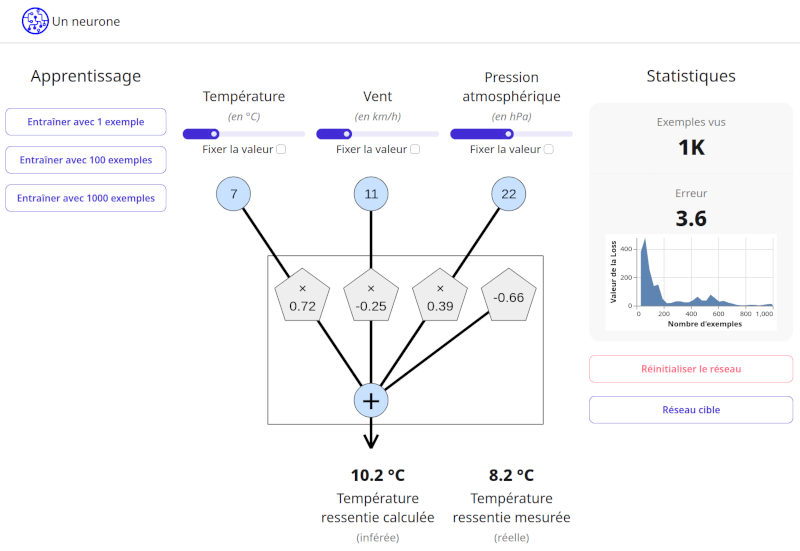

Un reseau de 1 neurone pour la température ressentie
====================================================

Il s'agit d'une application web qui permet de simuler un réseau de 1 neurone qui détermine la température ressentie à aprtir de la température réelle, la vitesse du vent et la pression atmosphérique.

Cette application permet :

- d'entraîner le réseau
- de faire des prédctions (phase d'inférence)
- de visualiser l'évolution de la Loss

Cette application peut être utilisée dans le cadre de l'enseignement de l'informatique au collège et lycée.

Elle est déployée sur https://mediation-informatique-strasbourg.github.io/Simulateur-NN/

Installation
------------

    npm install

Lancer l'application en mode "développeur", avec rechargement automatique
-------------------------------------------------------------------------

    npm run dev -- --open

Développer
----------

Formattage automqatique :

    npm run format

Analyse syntaxique :

    npm run lint

Vérification du typage

    npm run check

Références
----------

- https://wandb.ai/mostafaibrahim17/ml-articles/reports/A-Deep-Dive-Into-Learning-Curves-in-Machine-Learning--Vmlldzo0NjA1ODY0
- https://medium.com/duke-ai-society-blog/training-neural-networks-for-binary-classification-identifying-types-of-breast-cancer-keras-in-r-b38fb26a500c
- https://artemoppermann.com/activation-functions-in-deep-learning-sigmoid-tanh-relu/
- https://www.tensorflow.org/tutorials/keras/keras_tuner
- https://medium.com/@chamara95.eng/neural-network-example-using-fashion-mnist-dataset-c19b48c86cf1

Références techniques
---------------------

- https://github.com/idris-maps/svelte-parts/blob/master/src/lib/DropFile.svelte
- https://blog.filestack.com/how-to-read-uploaded-file-content-in-javascript/
- https://dev.to/dailydevtips1/vanilla-javascript-canvas-images-to-black-and-white-mpe
- https://plotly.com/javascript/plotlyjs-events/
- https://github.com/plotly/plotly.js/blob/master/src/plot_api/plot_config.js

Source
------

Cette application est basée sur celle de Nicholas Wolff (@nwolff) disponible sur ce dépôt : https://github.com/nwolff/cours-NN

License
-------

Copyright (c) 2023-2026 Nicholas Wolff

This project is licensed under the Creative Commons Attribution-ShareAlike 4.0 International License - see the [LICENSE](LICENSE) file for details.
